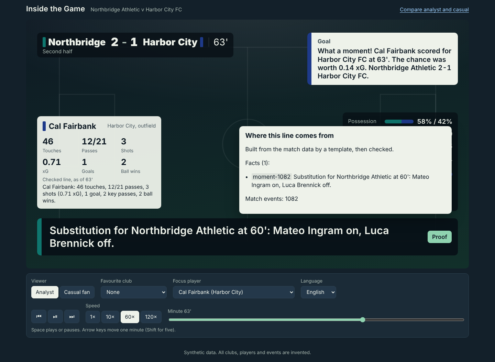
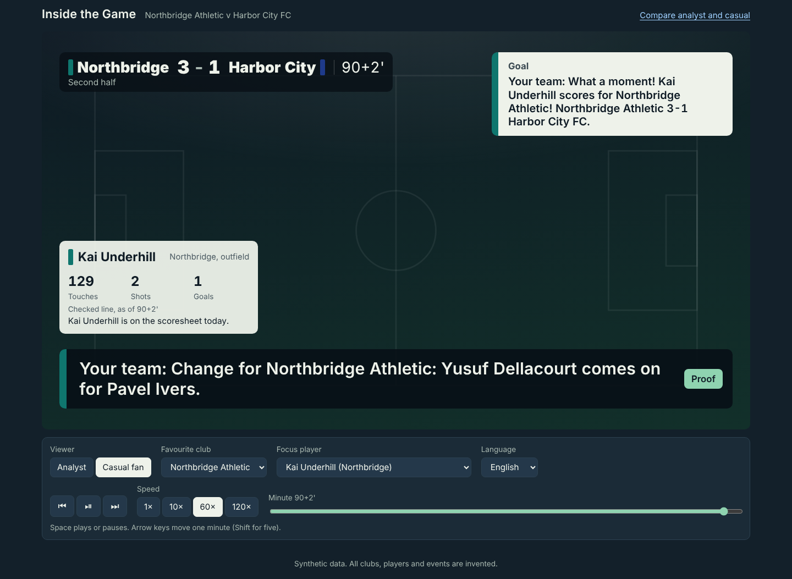
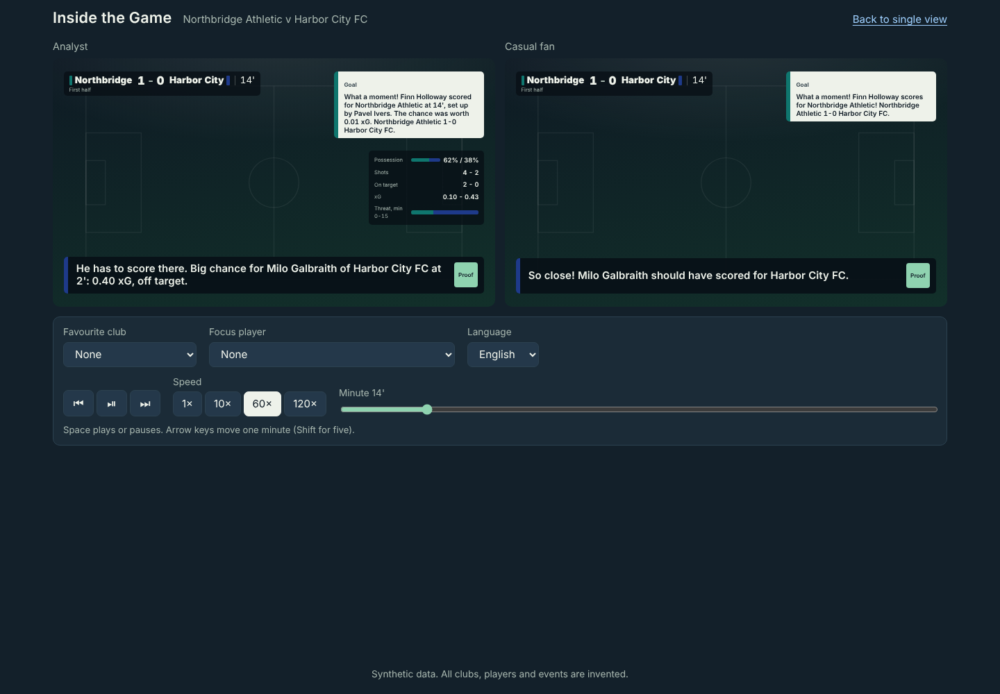

# Fan overlay

A static, broadcast-style overlay that plays a match back from baked JSON. It needs no server, no model and no build step. Every line on screen passed the FactChecker and carries its proof.

```
itg-bake --web  ->  web/data/<match_id>/*.json  ->  web/index.html (vanilla JS)  ->  any static host
```

## Files in a bundle

| File | What the page uses it for |
|---|---|
| `manifest.json` | Teams (invented names and colors), lineups, language status, profiles, favourite options, focus players, provider |
| `timeline.json` | One row per event: `event_id`, `period`, `clock`, `display_clock`, `type`, `team`, `player`, `score` after the event. Drives the clock and score bug |
| `stats.json` | Running team stats at each match minute (possession, shots, on target, xG, momentum share), for the analyst strip |
| `facts.json` | Every fact an item cites, for the proof tooltip |
| `overlay.<profile>.json` | OverlayItems for `analyst` or `casual` |
| `overlay.<profile>.<club>.json` | The same, framed for a favourite club |
| `players/<id>.json` | A focus player's items, card lines and running card (top 6 by involvement, plus both goalkeepers) |
| `recap.<profile>.json` | The verified match report |

## OverlayItem contract (v1)

Schema: [`overlay.schema.json`](overlay.schema.json). Tests validate every item against it.

| Field | Meaning |
|---|---|
| `id` | Unique within the bundle: `match:profile:favourite:slot:fact` |
| `match_id`, `profile` | Which match and viewer profile |
| `lang` | Language of `text` (always `en`; other languages are in `translations`) |
| `at_event`, `period`, `clock`, `display_clock` | When it appears: the triggering event and its clock |
| `show_for_s` | Minimum on-screen time in wall-clock seconds, at any playback speed |
| `slot` | `ticker`, `alert`, `score`, `stats` or `card` |
| `kind` | Moment kind: `goal`, `save`, `momentum_swing`, `player_card`, ... |
| `text` | The line, in English |
| `translations` | `{lang: {text, ok}}`. `ok` is true only if the translation passed the number and name checks |
| `fact_ids`, `evidence` | The facts it cites and the match events behind them |
| `source` | `model`, `template` or `template-fallback` (a model line was blocked) |
| `blocked` | Why the model line was not used (fallbacks only) |
| `boost` | Favourite-club moment: shown first and longer |

Example (casual, favourite club Northbridge):

```json
{
 "id": "NBA-HCF-7:casual:NBA:alert:moment-254",
 "match_id": "NBA-HCF-7", "profile": "casual", "lang": "en",
 "at_event": 254, "period": 1, "clock": 804.1, "display_clock": "14'",
 "show_for_s": 8.0, "slot": "alert", "kind": "goal",
 "text": "Your team: What a moment! Finn Holloway scores for Northbridge Athletic! Northbridge Athletic 1-0 Harbor City FC.",
 "translations": {"es": {"text": "...", "ok": false}},
 "fact_ids": ["moment-254"], "evidence": [252, 253, 254],
 "source": "template", "blocked": [], "boost": true
}
```

## Slots and timing

| Slot | Where | Holds |
|---|---|---|
| `ticker` | Lower third | Narration. Stays until the next line replaces it |
| `alert` | Top right | Goals and cards. Clears after `show_for_s` |
| `score` | Under the score bug | Half-time and full-time |
| `stats` | Analyst strip | Momentum calls (shown in the ticker for casual) |
| `card` | Player card | Card lines for the focus player |

Timing: an item becomes due when match time passes its event. A shown item stays for at least `show_for_s` wall seconds; if several items come due meanwhile (at 60× or 120×), only the newest waits and the older ones are skipped. Seeking shows the latest due item straight away.

## Personalization rules

- **Analyst:** full lines, with numbers and xG, plus the stats strip.
- **Casual:** at most 20 words, no jargon (xG, expected goals, threat share, final-third entries, possession_id), and at most one number besides the score. A line that breaks a rule is swapped for the casual template line and marked `template-fallback` with the reason.
- **Favourite club:** that club's moments (by the cited fact's team) get a "Your team:" prefix, an extra 2 seconds on screen, and go first when two items share an instant. The prefix adds no names or numbers, so the FactChecker still passes. Kickoff, half-time and full-time stay neutral.
- **Focus player:** the card shows running figures from `player-<id>@<event>` facts; every card line passes the FactChecker.
- **Language:** Spanish is offered only when the manifest marks it `verified` or `partial`. A line whose translation is not `ok` is shown in English with a note.

## Run and deploy

```bash
itg-bake --match data/samples/NBA-HCF-7 --web
python -m http.server -d web 8000     # http://localhost:8000/  and  ?view=compare
```

Deep links: `?view=compare`, `?profile=casual`, `?fav=NBA`, `?player=NBA-10`, `?lang=es`, `?speed=120`, `?t=63` (minute), `?at=1120` (event), `?autoplay=1`.

All URLs are relative, so the `web/` folder works from a GitHub Pages sub-path as is.

Tests: `tests/test_personalize.py`, `tests/test_bake_web.py`, `tests/test_web_headless.py` (browser, skipped without Playwright), and `node --test web/tests/engine.test.mjs` for the playback logic.




